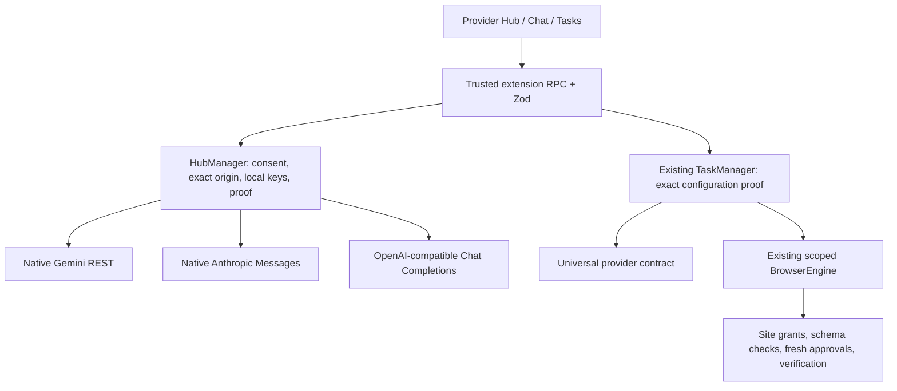

# M2.1 provider architecture — 0.2.1

The existing M0/M1 reader, conversation storage and M2 scoped browser engine remain in place. No M3 planner, deployment, backend or new dependencies. Settings now own a versioned `hub` containing up to 40 local profiles, separate Chat/Tasks defaults, per-profile consent and independently recorded diagnostics.

`src/features/provider-hub/profiles.ts` defines strict profile/catalog/diagnostic schemas, endpoint validation, migration and status labels. `capabilities.ts` binds diagnostics to a SHA-256 fingerprint of the exact endpoint, model, key and request/capability configuration. The worker retains authoritative proof; PROFILE_SAVE rejects diagnostic fields from the UI. Changing configuration/key invalidates proof; name-only edits retain it. A fresh successful text test AND actual no-op tool/result roundtrip are required before selecting/starting Tasks. The browser engine never trusts the model's declared capability or a model-list result.

`HubManager` owns explicit draft probes, save/delete/default/export/key invalidation, timeout and cancellation. Probes contain dummy text only. The no-op function accepts a random nonce and `ping`; schema validation, exactly one prescribed call, a tool-result message and a second response consuming the nonce are all required. No browser tools are exposed during testing. Draft endpoints/keys are not saved implicitly. Matching diagnostics on already saved profiles may update their local health reports. Source exports omit key material, proof fingerprints and diagnostics; consent resets to false.

`Provider` standardizes listModels, testConnection, generate, stream, generateWithTools, cancel, getCapabilities and existing structured generation. `ProviderBase` supplies cancellation and capability flags. Native Gemini preserves functionCall/functionResponse IDs and thought signatures. Native Anthropic uses Messages/tool_use/tool_result and native SSE. Other presets share the OpenAI Chat Completions wire adapter, with explicit token-parameter, temperature and stream-usage options. Arbitrary headers/body scripts, Responses API emulation and arbitrary execution are not supported.

Transport uses header-only credentials, `redirect:'error'`, response-origin checks, finite response/SSE budgets, caller cancellation and request deadlines. Eligible network/500/502/503/504/529 failures can retry at most twice with backoff/jitter; diagnostics use zero retries. Billing, quota and 429 never retry. HTTP 503/529 have a separate temporary-outage code; malformed/truncated streams have a parser code. JSON and SSE in-band provider errors are classified before parsing content.

Chat follows only the explicit Chat default. A conversation belonging to another profile or API endpoint is blocked, with a new-conversation prompt; no history/page/task data is forwarded on switching. User-selected non-streaming Chat uses the same model/endpoint. Optional fallback requires explicit opt-in and a matching passing text proof, no emitted stream text, and an incompatible/broken-stream error. Auth/billing/quota/429/outage failures cannot trigger fallback. Tasks use the explicit Tasks default through `generateWithTools`, retaining all eleven existing tools and safety checks.

Storage migration is additive and idempotent: fixed Gemini/Groq settings become profiles with unchanged IDs, model, consent and per-request options. `key:gemini` and `key:groq` are retained in their original trusted storage area; IndexedDB `vistara-ai` version 1 and conversations are untouched. Invalid saved settings cause a preservation error rather than silent reset. Profile/key saves restore prior key/settings on write failure. Session storage remains the default; persistent storage applies only to an entered replacement key with explicit opt-in. All dynamic and orphan keys are included in log/history redaction. Removing a key clears compatibility proof.

Limitations: capability tests are observations of that configuration at that time, not lifetime guarantees; every actual request/action can still fail. Standard browser fetch does not expose why a redirect rejected, so a blocked redirect may surface as a generic network failure even though credentials were not forwarded. Native extension permissions, worker lifecycle, API CORS/account limits and live providers remain separate acceptance gates.

Controller profile mutations/diagnostics are locked before asynchronous authorization to prevent overlapping tasks/settings updates. Cancel remains available; the editor disables configuration fields while a diagnostic is running and cancellation during a host prompt prevents subsequent diagnostic dispatch.
